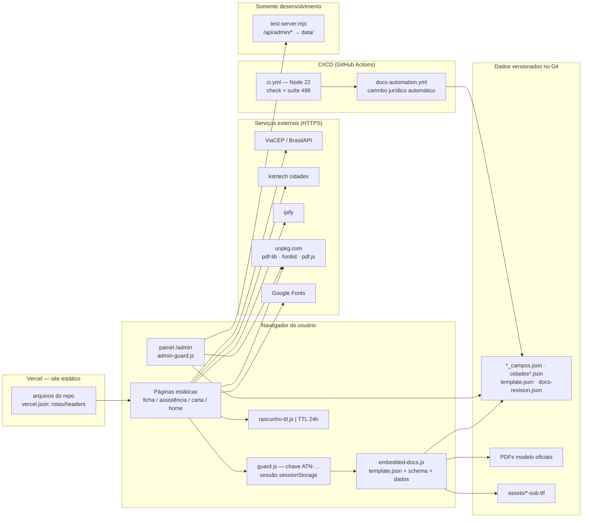
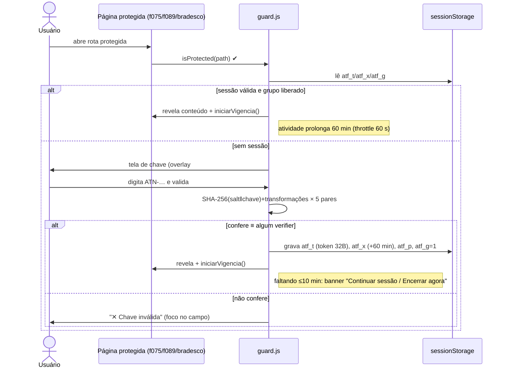
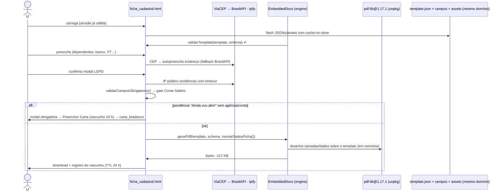
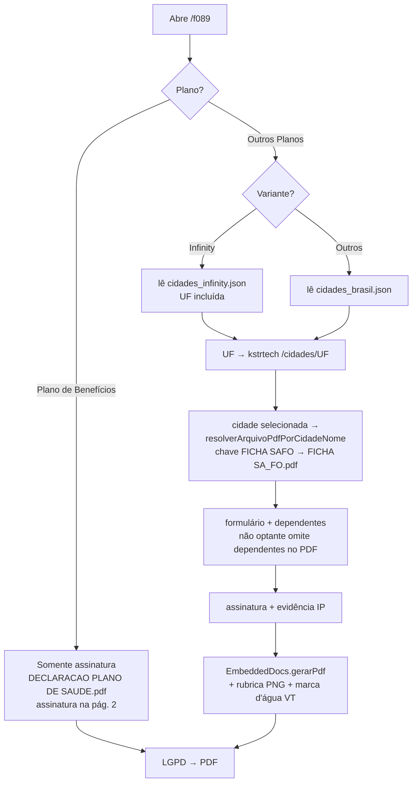
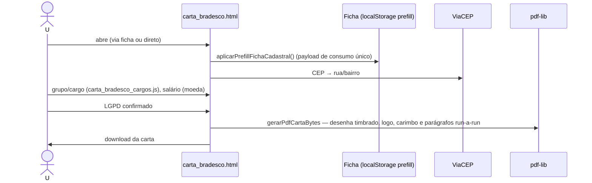
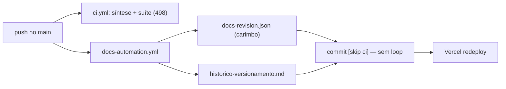
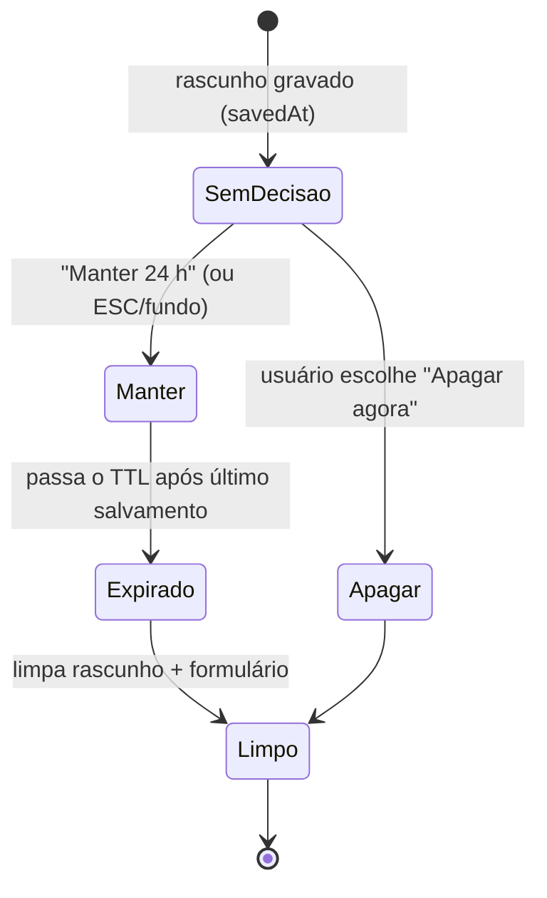

# AUDITORIA COMPLETA — Hub de Recrutamento & Seleção (Formulários de Admissão)

Consolidação, em documento único para leitura, dos seis entregáveis produzidos na auditoria somente-leitura. O conteúdo de cada parte é o texto original dos arquivos-fonte, sem alteração de forma; apenas os títulos foram recuados um nível para caber na estrutura de partes.

- **Data da auditoria:** 25/10/2026 · Somente leitura · Suíte verificada: 498 testes, 0 falhas (exit 0)
- **Fontes originais (preservadas):** [resumo-executivo.md](resumo-executivo.md) · [prd-retrospectivo.md](prd-retrospectivo.md) · [docs-tecnico.md](docs-tecnico.md) · [inventario.md](inventario.md) · [arquitetura-e-fluxos.md](arquitetura-e-fluxos.md) · [constatacoes-matriz.md](constatacoes-matriz.md)

**Sumário:**
1. Resumo executivo
2. PRD retrospectivo — funcionalidades e regras de negócio existentes
3. Documentação técnica — front-end e "back-end"
4. Inventário — telas, endpoints, entidades, integrações e storage
5. Arquitetura e fluxos diagramados
6. Matriz de constatações, débitos e referências de código

---

Earliest content (Parte 1) begins below.

---


# Parte 1 — Resumo executivo

*Fonte original: `resumo-executivo.md` ( headings recuados um nível na consolidação )*

## Resumo executivo — Auditoria do Hub de Recrutamento & Seleção (Formulários de Admissão)

**Data:** 25/10/2026 · **Escopo:** auditoria somente-leitura · **Método:** inspeção do repositório, rastreamento de fluxos no código e execução da suíte de testes local (nenhum código alterado, nenhuma dependência instalada).

---

### 1. O produto em uma frase

Aplicação **web estática** (sem backend em produção) por meio da qual candidato/RH preenchem formulários de admissão no navegador e **geram PDFs preenchidos sobre os documentos oficiais corporativos** — Ficha Cadastral F-075 (PR-011), Assistência Médica F-089 (PR-090), Declaração de Plano de Saúde e Carta de Abertura de Conta Salário Bradesco — com assinatura manuscrita em canvas, evidência técnica (documento, data/hora, IP) carimbada no rodapé e todos os dados de formulário **restritos ao dispositivo do usuário** (LGPD por desenho).

### 2. Problema de negócio atendido

- Elimina o preenchimento manual em papel/impressão: PDF oficial sai idêntico ao modelo, já preenchido e assinado.
- Reduz fricção do candidato (mobile-friendly, rascunho retomável por 24 h, copiar dados entre formulários, CEP autopreenchido).
- Custo operacional mínimo: hospedagem estática em Vercel, sem banco de dados, sem servidor, sem variáveis de ambiente.
- Conformidade LGPD documentada publicamente (hub `/Docs`: aviso de privacidade PO-026/027/029, política, termos, base legal, RIPD).

### 3. Público e perfis

| Perfil | Uso | Acesso |
|---|---|---|
| **Candidato** | Preenche e gera os PDFs (desktop ou mobile) | Chave episódica de acesso (família de 5 códigos `ATN-…`) — proteção client-side |
| **RH / operações** | Orienta links, valida PDFs, baixa modelos em branco | Mesmas chaves |
| **Administrador do painel** | Configura coordenadas, cidades, templates PDF; publica JSONs no repositório | Dois fatores client-side: e-mail exatamente `@atento.com` + código exclusivo do painel |
| **Técnico/manutenção** | Re-medir coordenadas, reextrair templates, CI/deploy | Git |

### 4. Funcionalidades principais (verificadas em código)

1. **Ficha Cadastral F-075:** fluxo progressivo por etapas, dependentes dinâmicos, vale-transporte, seleção bancária Bradesco/Next/Santander, gate "Conta Salário — Ainda vou abrir" que interrompe a geração e redireciona para a Carta; geração via **engine embarcada própria** (`EmbeddedDocs.gerarPdf`) sobre `template.json` declarativo (fonte definitiva, mesma engine do painel).
2. **Assistência Médica F-089:** dois fluxos — Plano de Benefícios (só assinatura na pág. 2 da declaração) e Outros Planos (ficha regional por UF/cidade).
3. **Carta Bradesco:** geração do zero com timbrado, cargos/tab groups (`carta_bradesco_cargos.js`), autopreenchimento a partir da Ficha, CEP por ViaCEP.
4. **Painel administrativo `/admin`:** overlay sobre os JSONs de coordenadas (nunca os edita diretamente), editor visual sobre o PDF, Field Builder, cidades, upload/versionamento de templates com rollback, exportação "formato original + overlay aplicado", histórico append-only.
5. **Hub Docs LGPD** e carimbos automáticos de revisão jurídica a cada push no `main` (GitHub Actions bot).

### 5. Arquitetura em 4 linhas

- **Front-end:** HTML5/CSS3/JS vanilla (ES2020+, zero frameworks), ~10,7 mil linhas inline nas 4 páginas + painel.
- **PDF:** `pdf-lib@1.17.1` via CDN com SRI; engine declarativa `embedded-docs.js` (template JSON + assets PNG extraídos do documento oficial + subsets de fonte de 17–20 KB → PDF de ~117 KB).
- **"Backend":** nenhum em produção. Em dev, `scripts/test-server.mjs` emula rotas e expõe `API /api/admin/*` local (grava em `data/`, gitignored). O painel detecta o modo automaticamente (API ↔ exportação).
- **Autenticação:** guardas client-side derivadas (salt + SHA-256 + transformações), códigos reais nunca versionados.

### 6. Qualidade e infraestrutura

- **Suíte local re-executada nesta auditoria: 498 testes passaram, 0 falharam** (`node scripts/run-test.mjs`, exit 0).
- **CI:** GitHub Actions (Node 22) — sintaxe JS, estrutura/JSONs, suíte completa em todo push/PR.
- **Bot de docs:** workflow `docs-automacao.yml` regenera e commita carimbo de revisão jurídica e histórico de versões a cada push no `main` (commit `[skip ci]`, com retentativas).
- **Deploy:** Vercel, preset Other, sem build step; rotas/headers geridos por `vercel.json` (CSP com allowlist de integrações, HSTS, COOP/COEP, Permissions-Policy restritiva).

### 7. Constatações principais

| # | Constatação | Status |
|---|---|---|
| 1 | Arquitetura estática sem backend, sem banco, sem variáveis de ambiente — como documentado | ✅ Verificada |
| 2 | Dados de formulário apenas no dispositivo; rascunho TTL 24 h sem retenção indefinida; copys LGPD alinhadas ao aviso publicado | ✅ Verificada |
| 3 | Autenticação client-side é **decisão documentada do projeto**, não substitui server-side — conteúdo protegido é entregue ao navegador e um usuário avançado pode contornar a guarda | ✅ Verificada (limitação declarada no próprio código) |
| 4 | Segredos não versionados: `keys*.txt` e `data/` gitignored; apenas verificadores derivados no código | ✅ Verificada |
| 5 | Persistência do painel em produção é **manual** (exportar → commit → deploy) — não há gravacao central de configurações em produção | ✅ Verificada (limitação por design) |
| 6 | Sem telemetria/analytics/observabilidade — falhas de API surfacem via toasts | ✅ Verificada (mesma ausência que facilita a privacidade, dificulta diagnóstico em produção) |

### 8. Principais riscos e recomendações (detalhe na matriz)

1. **Proteção de branch ausente no `main`** — qualquer push direto publica (limitação operacional já documentada; CI é o único portão).
2. **Dependências externas via CDN** (unpkg, Google Fonts) em rede corporativa restritiva podem indisponibilizar geração de PDF — mitigável hospedando assets no domínio.
3. **Número mágico do gate de tamanho:** o PDF embarcado (~117 KB) cabe no limite de 248 KB de anexo; re-geração de fontes com TTF completo volta o PDF a ~2,7 MB sem falha automática durante o CI — recomenda-se teste de tamanho na suíte.
4. **Higiene local:** pastas de trabalho `.kilo/worktrees/`, `.tmp_render`, `.tmp_viz` e `scratch_*.json` existem no disco mas estão ignoradas pelo Git (nenhuma vazou para o repositório).

### 9. Documentos desta auditoria

| Documento | Conteúdo |
|---|---|
| [prd-retrospectivo.md](prd-retrospectivo.md) | PRD retrospectivo — funcionalidades e regras de negócio existentes |
| [docs-tecnico.md](docs-tecnico.md) | Técnica de front-end e do "back-end" (guards, engine, API local, painel) |
| [inventario.md](inventario.md) | Inventário de telas, endpoints, entidades, integrações e chaves de storage |
| [arquitetura-e-fluxos.md](arquitetura-e-fluxos.md) | Diagramas (Mermaid) de arquitetura e fluxos ponta a ponta |
| [constatacoes-matriz.md](constatacoes-matriz.md) | Matriz verificada/inferida/não confirmada + débitos + referências de código |

### 10. Pendências que exigem confirmação humana

- Status do CI no GitHub (runs lá na nuvem) e estado do deploy na Vercel — não verificáveis 100% offline; local está verde e o `vercel.json` é a fonte de verdade versionada.
- Política real de expiração/rotação das chaves corporativas `ATN-…` (conteúdo de `keys-testes.txt` foi deliberadamente não lido) — administrativo, fora do escopo técnico.

# Parte 2 — PRD retrospectivo — funcionalidades e regras de negócio existentes

*Fonte original: `prd-retrospectivo.md` ( headings recuados um nível na consolidação )*

## PRD retrospectivo — Formulários de admissão (estado atual, 25/10/2026)

**Objetivo:** descrever as funcionalidades e regras de negócio **que existem hoje**, com evidência de código. Não é um PRD prospectivo. Complementa [PRD.md](../PRD.md) (prospectivo) e [MANUTENCAO.md](../MANUTENCAO.md) (operações).

---

### 1. Funcionalidades existentes

#### 1.1 Home (`index.html`, rota `/`)
- Hub de navegação: cards para F-075, F-089, Carta Bradesco e **Configurações** (painel), modal de instruções, identidade visual "Gradiente + Tangerina" (`#01426A` como cor institucional).
- Não carrega `guard.js` (pública) — travado pela suíte (run-test.mjs:178).

#### 1.2 Ficha Cadastral F-075 (`ficha_cadastral.html`, rotas `/f075`, `/ficha_cadastral`)
| Funcionalidade | Evidência |
|---|---|
| Fluxo progressivo por etapas (percentuais por seção, etapas seguintes reveladas) | `calcularPercentuaisSecoes()` (ficha_cadastral.html:2800), `atualizarVisibilidadeEtapas()` (:2878) |
| Dependentes dinâmicos (adicionar/remover linhas, limite no código) | `adicionarDependente()` (:2957), `lerDependentesFormulario()` (:2928) |
| Conta bancária com regras por banco (Bradesco/Next/Santander) e gate da Conta Salário | `tipoContaEh*` (:2581–:2595), `sincronizarGateContaSalario()` (:2675) |
| Vale-transporte com marca d'água "não optante" | `atualizarUiValeTransporteNaoOptante()` (:2484), `desenharMarcaDaguaNaoOptanteValeTransporte()` (:2540) |
| CEP: ViaCEP com fallback Brasil API | `consultarCep()` (:2038), fetch ViaCEP (:2041), fetch BrasilAPI (:2057) |
| Assinatura manuscrita (canvas → PNG) + opção "não assinar manualmente" | `initAssinaturaCanvas()` (:2182), `canvasAssinaturaParaPngArrayBuffer()` (:2278) |
| Evidência técnica carimbada no rodapé do PDF (doc, data/hora, IP) | `caixaRodapeEvidenciaPdf()` (:2357), IP via `api.ipify.org` (:2305) |
| Geração do PDF pela engine embarcada (mesmo caminho do painel) | `EmbeddedDocs.gerarPdf` (:3885), template carregado por HTTP com `validarTemplate` (:3743–:3749), dados pela `montarDadosFicha()` (:3779) |
| Critério的血 de bloqueio: "Ainda vou abrir" sem agência/conta interrompe a geração e exige a Carta | `pendenciaContaSalarioSemDados()` + `modalContaSalarioSemDados`, ação única **Preencher Carta** (MANUTENCAO §4, Teste 20) |
| Cópia de dados para a Assistência | `construirPayloadCopiaParaAssistencia()` (:3010), `salvarPayloadCopiaAssistenciaNoStorage()` (:3070) |

#### 1.3 Assistência Médica F-089 (`assistencia_medica.html`, rotas `/f089`, `/assistencia_medica`)
| Funcionalidade | Evidência |
|---|---|
| Escolha inicial: **Plano de Benefícios** (só assinatura na pág. 2 da declaração) ou **Outros Planos** (ficha completa regional) | `ehPlanoBeneficios()`/`ehOutrosPlanos()` (:1421–:1424), `gerarPDF()` ramifica (:3228) |
| Outros Planos: variante Infinity usa lista com UF (`cidades_infinity.json`); demais usem o catálogo `cidades_brasil.json` | `usaListaInfinity()` (:1430), `obterMapaCidadesAtivo()` (:1433) |
| UF → municípios via API kstr (lista completa, ordenada) | `buscarMunicipiosPorUf()` (:1822) |
| Ficha regional resolvida pelo nome da cidade → arquivo físico | `resolverArquivoPdfPorCidadeNome()` (:1491) |
| Dependentes (cônjuge + filhos 2–4) com campo DNV condicionado à idade em dias | `idadeFilhoEmDiasAteHoje()` (:1608), `filhoDeveExibirCampoDnv()` (:1625) |
| "Não optante" omite a seção de dependentes no PDF | MANUTENCAO §5, RF-22 |
| Download de modelo em branco | `baixarPdfVazioExecucao()` (:3429) |
| Consumir payload copiado da Ficha ao abrir | `tentarAplicarCopiaFichaCadastral()` (:2939) |

#### 1.4 Carta Bradesco (`carta_bradesco.html`, rotas `/bradesco`, `/carta_bradesco`)
| Funcionalidade | Evidência |
|---|---|
| Geração do zero com timbrado (logo/carimbo PNG) e `carta_bradesco_cargos.js` (grupos/cargos TB-047_09) | `carregarAssetsCarta()` (:1120), `preencherSelectGrupos()` (:678) |
| Autopreenchimento a partir da Ficha | `aplicarPrefillFichaCadastral()` (:1499) |
| CEP ViaCEP | `consultarCep()` (:818) |
| Formatação de moeda e salário | `maskMoeda()` (:905), `moedaParaPdfSemSimbolo()` (:918) |
| Geração de PDF escrita em parágrafos run-a-run | `desenharParagrafo()` (:1144), `gerarPdfCartaBytes()` (:1227) |

#### 1.5 Sessão de acesso entre formulários (`guard.js`)
| Regra | Evidência |
|---|---|
| Chave necessária só na inserção inicial; concede o grupo inteiro F-075/F-089/Carta nesta aba | `grantSession()` (guard.js:197) marca `atf_g=1` sobre todos os caminhos de `PROTECTED`; `sessionValid()` (:183) aceita o grupo |
| Acesso direto sem sessão pede sempre a chave | `createAuthUI()` no `DOMContentLoaded` (guard.js:369) |
| Expiração 60 min com **janela deslizante por atividade** (throttle 60 s; clique/tecla/toque/retorno à aba) | `iniciarVigencia()` (guard.js:335), `registrarAtividade()` (:231), `EXPIRY_MS`/`REFRESH_THROTTLE_MS`/`AVISO_FALTA_MS` (:50–:54) |
| Banner a ≤ 10 min da expiração: "Continuar sessão" / "Encerrar agora"; ao vencer, sessão limpa e tela da chave recarrega | `mostrarBannerExpiracao()` (guard.js:297), `agendarAviso()` (:280), `encerrarSessaoPorExpiracao()` (:240) |
| `/admin` apartado (guard dedicado) | `PROTECTED` não contém `/admin`; `admin-guard.js` independente |

#### 1.6 Rascunho LGPD (todas as páginas, `rascunho-ttl.js`)
| Regra | Evidência |
|---|---|
| TTL fixo de 24 h **desde o último salvamento**, sem retenção indefinida | `expirou()` em rascunho-ttl.js; política documentada em MANUTENCAO §7.2 |
| Modal de decisão ao abrir com rascunho sem decisão e após gerar o PDF | `verificarAposSalvar()` chamado por `salvarRascunhoLocalSincrono()`/`salvarRascunho()`; "Apagar rascunho agora" × "Manter por 24 h"; ESC/fundo = manter |
| Rascunho versionado por página | chaves e versão em MANUTENCAO §7.2 (`ficha_v2`, `assist_v5`, `carta_v1`) |
| Timeout do modal agendado por `agendarModal()` — quando expira com a página aberta, limpa o formulário junto | MANUTENCAO §1 §7.2 |

#### 1.7 Painel Administrativo (`/admin`)
| Funcionalidade | Evidência |
|---|---|
| Autenticação apartada: e-mail exatamente `@atento.com` + código exclusivo do painel | `isCorporateDomain()` (admin-guard.js:67 recusa subdomínios e `.com.br`), corpus `CG` (:37–:45) independente das 5 chaves dos formulários |
| Modelo **overlay**: os JSONs do repositório são a fonte primária e o painel nunca os edita diretamente | MANUTENCAO §9.1; `docEfetivoParaRepositorio` — export com overlay vazio é bit-a-bit igual ao do repo (auditoria de invariante) |
| Editor visual de coordenadas sobre o PDF, Field Builder, cidades, upload/versionamento de templates + rollback físico, histórico append-only | MANUTENCAO §9.1 (§10, §11, §18, §23/§24, §26) ; validação de schema no gate de publicação (`validarDocCampos`) |
| Persistência adaptativa: modo API (dev) ↔ modo exportação (produção estática) | `detectMode()` (persistence.js:52); API local em scripts/test-server.mjs:152–:278 |
| Configurações com regra "config sem consumidor não existe" | `CONFIG_DEFS` — toda chave lida em um fluxo (MANUTENCAO §9.1 §22) |
| Exportação fecha o ciclo painel → repo | **Exportar arquivos do repositório (efetivos)** regenera 4 JSONs com overlay aplicado (MANUTENCAO §9.1) |
| localStorage PROIBIDO como banco administrativo | persistence.js:26 (declaração de convenção) |

#### 1.8 Hub Docs LGPD (`/Docs`)
- Aviso de privacidade (PO-026_04/PO-027_04/PO-029_05, DPO dpo-br@atento.com.br), política de privacidade, termos, base legal, RIPD, linha de resposta a incidentes, governança, baseline de segurança, fluxo de dados.
- Rodapé "Última validação" lido de `Docs/docs-revision.json` por `Docs/doc-revision.js` (carimbo regenerado a cada push no `main` pelo workflow `docs-automacao.yml`).

### 2. Regras de negócio consolidadas (máx. prioridade)

1. **PDF oficial é inviolável:** o arquivo em disco nunca é alterado; tudo é desenhado por cima na memória e baixado (RF-30).
2. **Dados permanecem no dispositivo:** nenhum formulário envia dados a servidor; persistência = `localStorage` (rascunho TTL 24 h) + `sessionStorage` (sessão de acesso); sem cookies de rastreamento.
3. **Chave de acesso uma única vez por aba** para o grupo de formulários; `/admin` exige fator duplo e código próprios.
4. **LGPD modais obrigatórias:** confirmação antes de exportar; decisão sobre o rascunho na primeira visita com rascunho e após cada geração de PDF.
5. **Coordenadas em pontos PDF, origem inferior esquerda** (convenção pdf-lib); os JSONs `*_campos.json` são a única fonte de geometria.
6. **Derivação sincronizada:** se a versão da chave de rascunho de uma página muda, o bloco `RascunhoTTL.init(...)` precisa acompanhar (travado pela suíte, teste 18).
7. **Chave do catálogo `FICHA SAFO` ↔ arquivo físico `FICHA SA_FO.pdf`** precisa bater nas pontas em `assistencia_medica.html` e `admin/panel.js` (teste 14.6b).
8. **Log de incluição no PDF da assistência (Outros Planos)**: metadados + IP + data/hora com a assinatura (RF-23).

### 3. Fora de escopo atual (sem vestígios no código)

Envio por e-mail, ATS/ERP, assinatura ICP-Brasil, multi-idioma, exercício de direitos do titular na ferramenta (canalizado pelo DPO corporativo) e qualquer automação de submissão.

### 4. Versionamento e governança

SemVer com tags `v0.1.0` → `v1.0.0`; branch única `main` com histórico linear; Conventional Commits com escopos `forms`, `pdf`, `admin`, `security`, `ui`, `embedded`; CI obrigatório antes do merge; a proteção formal de branch ainda não foi aplicada (procedimento descrito em MANUTENCAO §11.1).

# Parte 3 — Documentação técnica — front-end e "back-end"

*Fonte original: `docs-tecnico.md` ( headings recuados um nível na consolidação )*

## Documentação técnica — front-end e "back-end" (estado verificado, 25/10/2026)

Auditoria somente-leitura. Todas as conclusões abaixo foram conferidas no código; onde não foi possível confirmar diretamente, está marcado na [matriz de constatações](constatacoes-matriz.md).

---

### 1. Front-end

#### 1.1 Stack e versões

| Camada | Tecnologia | Versão/última | Evidência |
|---|---|---|---|
| Linguagem | JavaScript ES2020+ vanilla, sem framework/bundler | — | inline em `ficha_cadastral.html` (4.359 linhas), `assistencia_medica.html` (3.811), `carta_bradesco.html` (1.555), `index.html` (443) |
| Geração de PDF | [pdf-lib](https://github.com/Hopding/pdf-lib) via unpkg com **SRI** (`integrity="sha384-weMABw…`") | 1.17.1 (pinado) | ficha_cadastral.html:1827, assistencia_medica.html:1326, carta_bradesco.html:653; admin/index.html:690 (sem SRI no painel — ver débitos) |
| Fontkit | `@pdf-lib/fontkit` via unpkg | 1.1.1 | ficha_cadastral.html:1830, admin/index.html:693 |
| Preview de PDF no painel | `pdfjs-dist` via unpkg | 3.11.174 | admin/index.html:694 |
| Dev-dependências (Node) | `pdf-lib@^1.17.1`, `fonteditor-core@^2.6.3` (subsets de fonte) | — | package.json |
| Fontes web | Google Fonts (DM Sans/DM Mono; Poppins nos guards/Docs) | — | CSP de vercel.json (`fonts.googleapis.com`/`fonts.gstatic.com`) |

#### 1.2 Estrutura e organização

- **Sem build step**: arquivos servidos como estão; a "organização de módulos" é por convenção de arquivos na raiz.
- JS das páginas é **inline no `<body>`** (uma SPA leve por página); módulos compartilhados na raiz: `guard.js`, `admin-guard.js`, `rascunho-ttl.js`, `embedded-docs.js`, `shared-header-nav.css`.
- Painel: `admin/index.html` (+ `panel.js` 5.599 linhas, `persistence.js` 258, `panel.css` 651).
- Dados sob `Docs/` (hub LGPD), `scripts/` (17 utilitários Node/Python), `ficha-cadastral-embutido/` (POC/template declarativo, `template.json` com 10.716 linhas + `assets/`).

#### 1.3 Páginas, telas e responsabilidades

| Página | Rotas | Responsabilidade |
|---|---|---|
| `index.html` | `/` | Hub de escolha + modal de instruções + card Configurações |
| `ficha_cadastral.html` | `/f075`, `/ficha_cadastral(.html)` | F-075 completa (seções, etapas, dependentes, bancos, VT, assinatura) |
| `assistencia_medica.html` | `/f089`, `/assistencia_medica(.html)` | F-089 nos dois fluxos (Plano de Benefícios e Outros Planos/regionais) |
| `carta_bradesco.html` | `/bradesco`, `/carta_bradesco(.html)` | Carta de abertura de conta salário |
| `admin/index.html` | `/admin` (+variantes) | Painel de configuração v3 (nav por entidades, Ctrl+K) |
| `Docs/*.html` | redirects em vercel.json | Hub LGPD público |

#### 1.4 Estado, formulários e persistência

- **Estado do formulário:** DOM como fonte de verdade; serialização para rascunho via `coletarEstadoRascunho()`/`aplicarEstadoRascunho()` (assistência) e equivalentes na ficha/carta.
- **Rascunho:** `localStorage` com chaves versionadas (`atento.forms:v1:*`), expiração TTL 24 h via `rascunho-ttl.js` (meta em chave própria com `savedAt`, `sig`, `decidedAt`); persistência imediata em `change` no mobile.
- **Copys entre formulários:** `localStorage` com payloads de consumo único (`atento.forms:v1:cross_copy_ficha_para_assistencia`, `atento.forms:v1:carta_bradesco_prefill_v1`), removidos após consumo/descarte.
- **Sessão de acesso:** `sessionStorage` `atf_t/x/p/g` (formulários) e `adm_t/x/e` (painel); rascunho de config do painel em `adm_draft_cfg` (sessionStorage — nunca localStorage).
- **Não há framework de estado** nem biblioteca de formulários: máscaras/validações são implementadas à mão (ex.: `maskCPF`, `maskCep`, `maskTelefone`, `maskPIS`, `maskMoeda`, `aplicarMaiusculas`).

#### 1.5 Validações, erros e carregamento

- Validação pré-geração: `validarCamposObrigatorios()` em cada página (ficha e assistência marcam campos inválidos via `marcarCampoInvalido()` e toasts `showToast()`); assistência tem `validarCamposPlanoBeneficios()` dedicado.
- Falhas de rede (CEP, cidades, IP) aparecem como toasts; IPs externos possuem timeout via `AbortSignal.timeout` / `AbortController`.
- Template PDF e assets são carregados por `fetch` com `cache: "no-store"` e validados por `EmbeddedDocs.validarTemplate()` antes de qualquer geração (ficha_cadastral.html:3728–:3771). Painel detecta 404/HTML de host estático → modo exportação (persistence.js:52–:63).

#### 1.6 Comunicação com o exterior (a partir do navegador)

| Destino | Uso | Páginas |
|---|---|---|
| `unpkg.com` | pdf-lib/fontkit/pdfjs-dist | todas que geram PDF + painel |
| `viacep.com.br/ws/{cep}/json/` | CEP | ficha (:2041), assistência (:1931), carta (:818) |
| `brasilapi.com.br/api/cep/v1/{cep}` | fallback de CEP na ficha | ficha (:2057) |
| `api.kstrtech.com.br/cidades/{UF}` | lista de municípios da assistência | assistência (:1822); CORS declarado aberto (MANUTENCAO §6.1) |
| `api.ipify.org` | IP público para evidência do PDF | ficha (:2305), assistência (:2166) |
| `fonts.googleapis.com` / `fonts.gstatic.com` | tipografia | CSP de vercel.json |
| `api.ibge`/IBGE | `carregarMunicipiosIBGE()` existe (assistência:1839) — remanescente do fluxo antigo de municípios (hoje kstr é o ativo) | — |

Não há chamadas de API para um backend do próprio produto em produção.

#### 1.7 Autenticação de front-end (guards)

- `guard.js` — IIFE: 5 pares `{salt, verifier}` (`G`); pipeline `normalizar → concat(salt, entrada) → SHA-256 → inversão de bits por byte → XOR com máscara derivada do salt → troca de pares → hex` (`deriveVerifier()`, guard.js:66–:122). Formato da chave: inicia com `ATN`, 15 caracteres alfanuméricos (`verifyCode()`, guard.js:124). Sessão em `sessionStorage` com token aleatório de 32 bytes (`genToken()`).
- `admin-guard.js` — mesmo pipeline, corpus `CG` próprio (5 códigos exclusivos) **+** e-mail com domínio exatamente `@atento.com` (regex/`endsWith`; recusa subdomínios e `atento.com.br`). Sessão `adm_t/x/e`; refresh por atividade a cada 30 s (`scheduleRefresh()`). Mensagens de erro genéricas (não revelam qual fator falhou).
- **Limitação declarada no código:** proteção client-side; não substitui autenticação server-side (comentários de cabeçalho dos dois arquivos e README §Segurança).

#### 1.8 Responsividade e acessibilidad

- Layout responsivo collapse-to-1-column no mobile; selects com 16 px para evitar zoom do iOS; cabeçalho recolhível ao scroll (comportamento em rotação); guarda de teclado virtual via `visualViewport` nos overlays de autenticação (`createAuthUI`, guard.js:369).
- A11y em melhor-esforço: `role="alert"`/`aria-live` no banner de expiração, labels nos inputs do admin-guard, foco automático; **não há auditoria WCAG formal** (RNF-06 do PRD).

---

### 2. "Back-end"

#### 2.1 O que existe de fato

**Não há backend em produção.** O único componente server-side do produto é o **servidor local de desenvolvimento** (`scripts/test-server.mjs`, 377 linhas, Node ≥ 18 sem frameworks — `node:http`):

| Endpoint | Métodos | Comportamento (verificado) |
|---|---|---|
| `/` e rotas do `vercel.json` (`/f075`, `/f089`, `/bradesco`, `/admin`, docs) | GET | serve os arquivos e emula rewrites |
| `/api/admin/config` | GET/HEAD; PUT/POST | HEAD = sonda de modo; PUT/POST grava `data/admin-config.json` **com backup automático do estado anterior** em `data/backups/` (test-server.mjs:152–:197); corpo limitado a 5 MB; JSON inválido → 400 |
| `/api/admin/backup` | GET; GET `?id=` | lista backups ou baixa um específico (nome sanitizado via `sanitizarNomeArquivo`) |
| `/api/admin/upload` | POST | recebe Base64 JSON; exige `%PDF-` na assinatura (:210), limite 20 MB (→413), nome `.pdf` sanitizado; registra **versão física com timestamp** (`registrarVersaoUpload`, :26) e index `data/uploads.json` (cap 200 versões, sha256 por versão) |
| `/api/admin/uploads` | GET | lista versões de uploads |
| `/api/admin/uploads/restaurar` | POST | rollback físico: recopia a versão anterior (§26) |
| `/api/admin/historico` | GET/POST | eventos de auditoria em `data/historico.json` — **também é a sonda de detecção de modo** do painel (persistence.js:52) |
| `/api/admin/*` desconhecido | — | 404 JSON (test-server.mjs:278) |

Tudo grava em `data/` (gitignored). Em produção estática (Vercel preset Other, sem serverless), a API não existe e o painel opera em **modo exportação**: sessão do navegador + geração de JSON para o administrador versionar no repo.

#### 2.2 Tarefas agendadas / assíncronas

- **No navegador:** timer do TTL do rascunho (`tick()` + `agendarModal()` em rascunho-ttl.js), contagem do banner de sessão (`setInterval` 10 s), regeneração de guardas por atividade com throttle.
- **No GitHub Actions:** workflow `docs-automacao.yml` em todo push no `main` — regenera `Docs/docs-revision.json` + `Docs/historico-versionamento.md`, valida e commita (bot `github-actions[bot]`, mensagem `[skip ci]`, até 3 tentativas com re-sync); `concurrency: docs-automacao` sem cancelamento.
- **Nenhum cron, fila ou webhook** no produto.

#### 2.3 Engine de geração embarcada (`embedded-docs.js`, 768 linhas)

- API pública: `EmbeddedDocs.validarTemplate` e `EmbeddedDocs.gerarPdf` (UMD — funciona no browser e em Node, embedded-docs.js:48, :395).
- Entradas: `template.json` declarativo (página, 3 imagens, 161 barras pretas, 89 textos estáticos, 17 marcações) + schema de coordenadas (`*_campos.json`) + mapa flat de dados + assets (PNGs e fontes TTF em bytes) + fontkit opcional.
- Perfil de texto único da aplicação (`EmbeddedDocs.PERFIL_APP`: fonte 9 pt, `x+0,5`, baseline centrado na caixa) — MESMO caminho do painel e do `ficha_cadastral.html` (garantia de fidelidade, MANUTENCAO §3 nota).
- Sem fontkit (CDN bloqueada) cai em `fallback` Helvetica e reporta em `relatorio.fontesFallback` (degradação visível, não silenciosa).
- Fontes: subsets `*-sub.ttf` de 17–20 KB (Segoe apenas com glifo ❑ U+2751) → PDF de ~117 KB; TTFs completos só são insumo do `scripts/gerar-fontes-comprimidas.js`.

#### 2.4 Segurança do server local

- Sanitização de nome de arquivo (normaliza acentos, proíbe `..`, trim 120 chars) antes de qualquer `join`/`basename`.
- Validação de magia de PDF, limite de tamanho e rate-free (sem upload infinito: index cap 200).
- Sem autenticação nas rotas `/api/admin/*` — aceitável **apenas** porque o servidor é local de dev (escuta localhost); não expor à rede. (Ver débitos.)

#### 2.5 Logs e monitoramento

- Não há logging estruturado, APM ou telemetria em nenhuma camada (decisão LGPD-friendly). Diagnóstico hoje = console do navegador + suíte local.

---

### 3. Testes e CI

- **Suíte:** `scripts/run-test.mjs` (1.880 linhas) — 20 grupos de testes cobrindo estrutura, guards (janela deslizante/banner em Testes 2/7), rascunho TTL (18), LGPD Docs (19), gate da conta salário (20), painel v2/v3 (9–13), cidades/regionais (14.6b), auditoria de dados via `audit-panel.mjs` (17). **Execução desta auditoria: 498 passaram, 0 falharam (exit 0).**
- **Testes optativos por secret local:** arquivos dependentes de `keys-testes.txt` são marcados *skipped* sem o arquivo (convencão documentada, MANUTENCAO §9.1).
- **CI:** `.github/workflows/ci.yml` (push/PR) — `node --check` em todos os JS, presença/JSON-parse de estruturas e JSONs-chave, presença dos PDFs modelo, suíte completa. **Node 22**.
- **Bot de docs:** `docs-automacao.yml` (ver §2.2).

---

### 4. Infraestrutura e deploy

- **Vercel**, preset Other, sem build: `vercel.json` única fonte de rotas (`cleanUrls`, redirects para Docs, rewrites `/f075`,`/f089`,`/bradesco`,`/admin`).
- **Headers** (todas as rotas): CSP (allowlist de viacep/brasilapi/ipify/kstrtech + unpkg + Google Fonts; `worker-src blob:` para o worker do pdf.js), HSTS preload, X-Frame-Options DENY, X-Content-Type-Options, Referrer-Policy, Permissions-Policy restritiva, COOP same-origin, COEP require-corp, CORP same-origin, X-Permitted-Cross-Domain-Policies none.
- **Variáveis de ambiente:** nenhuma.
- **Ambientes:** produção (main → Vercel). Não há homologação dedicada; preview branches da Vercel são possíveis mas não configuradas como processo.
- **CI/CD:** GitHub Actions como acima; deploy automático a cada push no `main` (inclusive o commit do bot de docs).
- **Pontos críticos de disponibilidade:** unpkg (bibliotecas), Google Fonts, ViaCEP/BrasilAPI (CEP), kstrtech (municípios), ipify (evidência). Sem fallback nesses CDNs.

---

### 5. Dados e armazenamento

| Persistência | O que guarda | Tecnologia |
|---|---|---|
| `ficha_cadastral_campos.json` (911 ln) | schema + coordenadas F-075 | arquivo estático versionado |
| `assistencia_medica_campos.json` (969 ln) | schema + coordenadas F-089 | idem |
| `declaracao_plano_saude_campos.json` (83 ln) | coordenadas da declaração | idem |
| `cidades_brasil.json` (1.366 ln) / `cidades_infinity.json` (1.639 ln) | catálogo cidade→ficha regional (sem/ com UF) | idem |
| `ficha-cadastral-embutido/template.json` (10.716 ln) | template declarativo das camadas visuais | idem |
| `localStorage` | rascunhos TTL 24 h + copys entre formulários | navegador |
| `sessionStorage` | sessões de acesso + rascunho de config do painel | navegador |
| `data/` (dev) | admin-config, backups, uploads versionados, histórico | filesystem gitignored |
| Nenhuma | dados de candidatos | — |

- **Relacionamentos:** schema aninhado por seção (`dados_pessoais`, `endereco`, `dependentes.0..n`, `vale_transporte.itens`); sem chaves estrangeiras formais — é design documental.
- **Migrações:** por versionamento de schema/chave do rascunho (v2/v5/v1) com `lsMigrateLegacy()`/`lsRemoveDual()`; overlay do painel tem migração aditiva v1→v3 (nenhum dado descartado, MANUTENCAO §9.1).
- **Índices/backup:** n/a (não há banco). Backups: automáticos no modo API (`data/backups/`), export/import JSON no modo estático, versões físicas de PDF com sha256 (cap 200).

---

### 6. Segurança e privacidade (levantamento)

| Aspecto | Estado verificado | Ref |
|---|---|---|
| Credenciais/versionação | códigos reais NÃO versionados — apenas `{salt, verifier}` derivados; `keys*.txt`, `data/`, scripts auxiliares com chaves gitignored; `git ls-files` não contém arquivo de chaves | .gitignore; MANUTENCAO §9.1 |
| Headers/CSP | CSP com allowlist fechada de integrações, COEP/COOP/CORP, frame-ancestors none, HSTS preload | vercel.json |
| Uploads dev | validação de assinatura PDF, tamanho, sanitização de nome, versionamento imutável | test-server.mjs |
| Autenticação | client-side (limitação declarada e aceita por decisão de projeto); painel com fator duplo local (domínio + código exclusivo) | guards |
| Dados pessoais | permanecem no dispositivo; PDF sai "download" sem upload; rascunho TTL 24 h sem retenção indefinida; evidência de assinatura inclui IP público e data/hora no próprio PDF | rascunho-ttl.js; guards |
| Comunicações externas | fetch sobre HTTPS para 5 serviços de terceiros com dados de endereço/IP — CSP ações correspondentes | vercel.json §connect-src |
| Riscos identificáveis | 1) bypass da guarda client-side (documentado); 2) dependência de CDNs (indisponibilidade); 3) sessão em `sessionStorage` é apagada quando a aba fecha (by design); 4) e-mail do painel validado apenas por domínio (sem verificação de conta real); 5) sem CSP nonce/hash para inline scripts (`'unsafe-inline'` necessário pela arquitetura inline) | matriz |
| LGPD | hub Docs público + carimbo automático; rascunho com expiração; modais de decisão; sem cookies de tracking | Docs/, run-test 19 |

Valores de segredos não foram lidos nem registrados neste documento (política da auditoria). Nome das variáveis relevantes: nenhuma variável de ambiente existe no produto.

# Parte 4 — Inventário — telas, endpoints, entidades, integrações e storage

*Fonte original: `inventario.md` ( headings recuados um nível na consolidação )*

## Inventário — telas, endpoints, entidades, integrações e storage (25/10/2026)

Referências `arquivo:linha` conforme o estado do repositório na data desta auditoria.

---

### 1. Telas / páginas

| Rota(s) | Arquivo | Linhas | Papel | Proteção |
|---|---|---|---|---|
| `/` | [index.html](../index.html) | 443 | Home / hub | pública |
| `/f075`, `/ficha_cadastral(.html)` | [ficha_cadastral.html](../ficha_cadastral.html) | 4.359 | F-075 | guard.js |
| `/f089`, `/assistencia_medica(.html)` | [assistencia_medica.html](../assistencia_medica.html) | 3.811 | F-089 | guard.js |
| `/bradesco`, `/carta_bradesco(.html)` | [carta_bradesco.html](../carta_bradesco.html) | 1.555 | Carta Bradesco | guard.js |
| `/admin` (todas variantes `/admin/*`) | [admin/index.html](../admin/index.html) | — | Painel v3 | admin-guard.js |
| `/aviso-de-privacidade` → `/aviso-de-privacidade.html` → `Docs/aviso-de-privacidade.html` | Docs |.redirects vercel.json | Hub LGPD | pública |
| `/politica-de-privacidade` → `Docs/privacy-policy.html`, `/termos-de-uso` → `Docs/terms-of-use.html`, `/privacidade-e-seguranca` → `Docs/index.html`; legado `/Forms/:path*` → `/Docs/:path*` | Docs | redirects | Hub LGPD | pública |

Seções da F-075 (jornada): dados pessoais → endereço → contato → dependentes → conta bancária (+ Carta) → benefícios/vale-transporte → declaração/assinatura → LGPD → PDF.
Seções da F-089: tipo de adesão → (Plano de Benefícios: só assinatura) · (Outros Planos: UF/cidade → ficha completa → dependentes → assinatura) → LGPD → PDF.

---

### 2. Endpoints

#### 2.1 Produção (rotas estáticas Vercel — `vercel.json`)
| Rota | Destino |
|---|---|
| `/` | `index` (rewrite) |
| `/f075` / `/f089` / `/bradesco` / `/admin` | rewrites correspondentes |
| redirects | 6 regras para Docs + `/Forms/:path*` |

#### 2.2 API local de desenvolvimento (`scripts/test-server.mjs`)
| Endpoint | Método | Estado/confirmação | Efeito |
|---|---|---|---|
| `/api/admin/config` | GET/HEAD | 200 JSON / 200 sem corpo (HEAD como sonda de modo) | retorna overlay |
| `/api/admin/config` | PUT/POST | 200 `{ ok, arquivo, backup }`; 400 JSON inválido | grava `data/admin-config.json` + backup automático |
| `/api/admin/backup` | GET | 200 lista | lista backups |
| `/api/admin/backup?id=` | GET | 200 arquivo / 404 | baixa backup |
| `/api/admin/upload` | POST | 200 `{ ok, nome, bytes, destino, versao }`; 400 sem `.pdf`/sem `%PDF-`/sem dados; 413 >20 MB | grava PDF + registra versão (timestamp, sha256) |
| `/api/admin/uploads` | GET | 200 lista | index de versões (cap 200) |
| `/api/admin/uploads/restaurar` | POST | 200 rollback | recopia versão anterior |
| `/api/admin/historico` | GET/POST | 200 | lê/registra eventos (também sonda de modo) |
| `/api/admin/*` | outro | 404 JSON | test-server.mjs:278 |

**Autenticação:** nenhuma nas rotas API (restrito a uso local). **Parâmetros:** corpo JSON; query `id` em backup.

---

### 3. Entidades de dados

| Entidade | Fonte | Campos-chave | Relacionamentos |
|---|---|---|---|
| Schema F-075 | `ficha_cadastral_campos.json` | `documento` (id/título/versão), `campos.<secao>` com `coordenadas` por campo/opção | — |
| Schema F-089 | `assistencia_medica_campos.json` | idem + `tipo_adesao` (grupos de opções), `dependentes` (cônjuge + slots filhos) | — |
| Schema declaração | `declaracao_plano_saude_campos.json` | assinatura + `evidencia.coordenadas` | — |
| Catálogo de cidades | `cidades_brasil.json` | `REGIONAL`, `CIDADE`, `FICHA A UTILIZAR` (sem UF) | → arquivo `FICHA *.pdf` |
| Catálogo Infinity | `cidades_infinity.json` | idem + `UF` | → arquivo; usado no fluxo Infinity |
| Chave normalizada de cidade | painel | convenção `FICHA SAFO` (chave) ↔ `FICHA SA_FO.pdf` (físico) | trava de sincronia (run-test 14.6b) |
| Template declarativo | `ficha-cadastral-embutido/template.json` | `images`, `blackBars` (161), `whiteBoxes`, `checkboxes`, `texts` (89), `marcacoes` (17), `fontes`/`fonteCheckbox` (subsets) | → assets PNG + TTF |
| Overlay administrativo | `data/admin-config.json` (dev) | `campos_ficha`, `campos_declaracao`, `cidades` (patch), `cidades_novas`, `pdfs_meta`, `forms_meta`, `templates_versoes`, `configuracoes`, `campos_custom` | aplicado sobre os JSONs base (migração v1→v3 aditiva) |
| Versões de upload | `data/uploads.json` | `{nome, arquivo, data, bytes, sha256}` | → arquivos em `data/uploads/nome__TIMESTAMP.pdf` |
| Histórico do painel | `data/historico.json` | eventos append-only (+`desfazer`) | — |
| Carimbo de revisão | `Docs/docs-revision.json` | `ultimaValidacaoIso`, `gitCommit`, `gitRemote/branch` | lido por `Docs/doc-revision.js` |

---

### 4. Integrações externas

| Serviço | URL/pacote | Consumidor | Uso | Fallback |
|---|---|---|---|---|
| pdf-lib (CDN) | unpkg.com, pinado 1.17.1, SRI nas páginas públicas | todas as gerações | escrita em PDF | nenhum (crítico) |
| fontkit (CDN) | unpkg.com 1.1.1 | ficha + painel | embutir TTF subsets | fallback Helvetica declarado no relatório |
| pdf.js (CDN) | unpkg.com 3.11.174 | painel | preview/overlay visual | nenhum |
| ViaCEP | viacep.com.br/ws/{cep}/json | ficha, assistência, carta | endereço por CEP | BrasilAPI (somente ficha) |
| Brasil API | brasilapi.com.br/api/cep/v1 | ficha | fallback CEP | — |
| API kstrtech | api.kstrtech.com.br/cidades/{UF} | assistência | municípios por UF (CORS aberto declarado) | `carregarMunicipiosIBGE` existe como remanescente |
| ipify | api.ipify.org | ficha, assistência | IP público para evidência no PDF | omitido do bloco em falha (toast) |
| Google Fonts | fonts.googleapis/gstatic | páginas | tipografia | nenhum |

Todas permitidas no CSP (`connect-src`), exceto pdf.js/painel (scripts `unpkg` object). Sem chaves de API: todas as integrações são públicas/awaits por contrato.

---

### 5. Scripts do repositório (`scripts/`)

| Script | Linhas aprox. | Papel |
|---|---|---|
| run-test.mjs | 1.880 | suíte de rotas/proteção/privacidade (498 atual) |
| test-server.mjs | 377 | servidor local + API admin |
| audit-panel.mjs | — | auditoria do painel contra dados reais (`node:vm`), roda no Teste 17 |
| atualizar-docs-revision.mjs / gerar-historico-versionamento.mjs | 30/214 | carimbos LGPD (automatizados no push) |
| gerar-ficha-vazia.js / gerar-ficha-preenchida.js | 41/105 | geração via engine para comparativo/validação |
| gerar-fontes-comprimidas.js | — | subsets TTF (fonteditor-core), regera `*-sub.ttf` |
| generate-admin-verifiers.mjs | — | gera novos `{salt, verifier}` do painel (não contém segredos, versionado) |
| verify-no-leaked-keys.mjs / pre-commit-check.mjs | — | segurança (apenas locais, gitignored) |
| audit-mobile.mjs, tmp-audit-bancos-iguais.mjs | — | auditorias auxiliares de UI (contidas no repo de scripts) |
| conferir-caixas-v38.py, fidelidade-ficha.py, remapear-campos-v38.py, extract_template.py | — | perícia/extração/validação das coordenadas (Python 3) |
| gerar-docx-privacidade.py | 243 | gera `Docs/Servicos_Privacidade_Termos.docx` |

---

### 6. Chaves de armazenamento do navegador

| Chave | Tipo | Escopo |
|---|---|---|
| `atento.forms:v1:ficha_cadastral_rascunho_v2` | localStorage | rascunho TTL 24 h ficha |
| `atento.forms:v1:rascunho_ttl_ficha_v1` | localStorage | meta do TTL (`savedAt`, `sig`, `decidedAt`) |
| `atento.forms:v1:assistencia_medica_rascunho_v5` / `…rascunho_ttl_assist_v1` | idem | assistência |
| `atento.forms:v1:carta_bradesco_rascunho_v1` / `…rascunho_ttl_carta_v1` | idem | carta |
| `atento.forms:v1:cross_copy_ficha_para_assistencia` (legada `_v1`) | localStorage | payload de cópia entre formulários |
| `atento.forms:v1:carta_bradesco_prefill_v1` | localStorage | prefill da carta |
| `ficha_cadastral_nao_perguntar_copia_assistencia` | localStorage | preferência do usuário |
| `atf_t`, `atf_x`, `atf_p`, `atf_g` | sessionStorage | sessão dos formulários (token, expiração, caminhos legados, flag de grupo) |
| `adm_t`, `adm_x`, `adm_e` | sessionStorage | sessão do painel |
| `adm_draft_cfg` | sessionStorage | rascunho de config do painel (modo exportação) |
| — proibido — | localStorage como banco do painel | persistência.js:26 declara a proibição |

---

### 7. Workflows CI/CD

| Workflow | Gatilho | Ações |
|---|---|---|
| `ci.yml` | push em `main`, qualquer PR | `node --check` (14 grupos de arquivos), presença/parse de estruturas e JSONs, presença do template F-075, `run-test.mjs` |
| `docs-automacao.yml` | push em `main` (não disparado pelos commits do próprio bot), `workflow_dispatch` | regenera/commita carimbo de revisão e histórico (3 tentativas, `concurrency` não-cancelável,히 `[skip ci]`) |
| Vercel | push em `main` | deploy estático automático (sem build) |

# Parte 5 — Arquitetura e fluxos diagramados

*Fonte original: `arquitetura-e-fluxos.md` ( headings recuados um nível na consolidação )*

## Arquitetura e fluxos — auditória diagramada (25/10/2026)

Diagramas em Mermaid. Estado verificado no repositório; não descreve nada além do que existe.

---

### 1. Diagrama de arquitetura atual



**Leitura:** o cliente concentra 100% da lógica de dados; a edge (Vercel) só entrega arquivos e headers; a única escrita server-side do produto é do servidor **local** de dev em `data/`.

---

### 2. Fluxo A — Autenticação e sessão entre formulários



Falha tratada: expiração real → `encerrarSessaoPorExpiracao()` limpa as 4 chaves e recarrega (tela de chave volta). Navegação entre f075↔f089↔bradesco **não** repete a chave (`atf_g` cobre o grupo; `atf_p` mantém compatibilidade com sessões antigas).

---

### 3. Fluxo B — Ficha Cadastral → PDF (caminho feliz)



Tratamentos de falha: template/schema ausentes → toast e geração bloqueada; LGPD cancelado → nada é gerado; rascunho expira com a página aberta → modal + limpeza do formulário no vencimento.

---

### 4. Fluxo C — Assistência Médica (ramificação)



Dependência crítica: nome da cidade tem de bater entre o JSON da lista e `FICHA_UTILIZAR_PARA_ARQUIVO` nas duas pontas (app e painel); divergência = cidade sem template.

---

### 5. Fluxo D — Carta Bradesco



---

### 6. Fluxo E — Configuração (painel → aplicação pública)

```mermaid
sequenceDiagram
    actor A as Administrador
    participant AD as /admin (painel)
    participant DET as persistence.js detectMode()
    participant API as test-server.mjs (dev)
    participant REPO as JSONs/PDFs do repo
    participant VER as Vercel

    A->>AD: valida e-mail @atento.com + código exclusivo (CG)
    AD->>DET: sonda GET /api/admin/historico
    alt JSON ⇒ modo API (dev)
        AD->>API: PUT config (backup auto), POST upload (PDF assinatura/tamanho), POST historico
    else 404/HTML ⇒ modo exportação
        AD->>AD: sessão do navegador; Exportar JSON / Exportar arquivos do repo
    end
    AD->>AD: Editar overlay (Field Builder, editor visual, cidades)<br/>validarDocCampos no gate
    A->>REPO: substitui JSONs exportados (bit-a-bit = base + overlay)
    A->>VER: commit/push → deploy automático
    Note over A,VER: app pública lê os JSONs do repo — painel nunca lhes escreve direto
```

---

### 7. Fluxo F — Ciclo de docs LGPD (automático)



---

### 8. Fluxo G — Rascunho (TTL/decisão LGPD)



# Parte 6 — Matriz de constatações, débitos e referências de código

*Fonte original: `constatacoes-matriz.md` ( headings recuados um nível na consolidação )*

## Matriz de constatações, débitos e referências — 25/10/2026

Classificação por constatação: **[V]** verificada diretamente no código/config/execução · **[I]** inferida (descrita em documento do repositório, coerente com o código aqui conferido, não re-verificada linha a linha nesta auditoria) · **[N]** não confirmada / precisa de acesso externo.

Segredos: nenhum valor de token/senha/chave foi lido ou registrado (nem o conteúdo de `keys-testes.txt`).

---

### 1. Matriz

| # | Constatação | Status | Fundamento (arquivo:linha) |
|---|---|---|---|
| 1 | Aplicação estática sem backend produção, sem banco de dados, sem variáveis de ambiente | [V] | [vercel.json](../vercel.json) (rewrite/headers apenas); package.json (sem deps de runtime); README §Deploy; inventário §4 (5 APIs só leitura) |
| 2 | Stack front-end: JS vanilla ES2020+, pdf-lib 1.17.1 pinado com SRI, fontkit 1.1.1, pdf.js 3.11.174 | [V] | ficha_cadastral.html:1827/1830; assistencia_medica.html:1326; carta_bradesco.html:653; admin/index.html:690–694 |
| 3 | Autenticação client-side por derivados (salt + SHA-256 + transformações), 5 chaves de formulários, formato `ATN` + 15 alfanuméricos | [V] | guard.js:32–37 (G), :79/:139 (derive/verify); NFSR keys reais ausentes (git ls-files sem `keys*`) |
| 4 | Sessão de formulários: `sessionStorage` atf_t/x/p/g, expiração 60 min, janela deslizante throttle 60 s, banner a 10 min, grupo Ficha↔Assistência↔Carta sem repetição de chave | [V] | guard.js:22–:32 (G), :36 (PROTECTED), :50–:54 (constantes), :66–:122 (deriveVerifier), :124 (verifyCode), :144–:246 (sessão/grupo), :231–:347 (vigência/banner), MANUTENCAO §7.1.1 |
| 5 | Painel com fator duplo client-side (domínio exato `@atento.com` + código exclusivo em corpus `CG` distinto das chaves de formulários) | [V] | admin-guard.js:37–:45 (CG), :48/:67 (domínio); pipeline idêntico declarado e comparado |
| 6 | Limite declarado da guarda client-side (não substitui server-side) | [V] | comentário de cabeçalho guard.js:4–:10 e admin-guard.js:20–:22; README §Segurança |
| 7 | Rascunho com TTL de 24 h pós-último salvamento, modal de decisão, sem retenção indefinida | [I]→[V parcial] | rascunho-ttl.js (442 ln) conferido por rascunho (API `RascunhoTTL.init/verificarAposSalvar` chamada pelas páginas: ficha `salvarRascunhoLocalSincrono`, assistência após `gerarPDF`); detalhes de meta (`savedAt/sig/decidedAt`) conforme MANUTENCAO §7.2 — não refizemos o timer físico nesta auditoria |
| 8 | Chaves de storage versionadas por página conforme documentação | [V] | ficha_cadastral.html:1897 (`_v2`); busca de `LS_NS` nas demais páginas confirmou o mesmo namespace `atento.forms:v1:*` |
| 9 | CEP: ViaCEP em todos os fluxos + fallback BrasilAPI na ficha | [V] | ficha_cadastral.html:2041/:2057; assistencia_medica.html:1931; carta_bradesco.html:818 |
| 10 | Municípios da assistência via kstrtech (CORS aberto declarado) | [I] | assistencia_medica.html:1822 (chamada); CORS **declarado** em MANUTENCAO §6.1 — não testado em rede nesta auditoria |
| 11 | IP público de evidência via ipify | [V] | ficha_cadastral.html:2305; assistencia_medica.html:2166 |
| 12 | Geração unificada via `EmbeddedDocs.gerarPdf` (app público = painel = scripts) | [V] | ficha_cadastral.html:3885; assistencia_medica.html (gerarPDF:3228); admin/panel.js:2989; scripts/gerar-ficha-preenchida.js:98; embedded-docs.js:395 |
| 13 | Template declarativo (página + 3 imagens + 161 barras + 89 textos + 17 marcações) e subsets de fonte 17–20 KB ⇒ PDF ~117 KB | [I] | números extraídos de MANUTENCAO §2 (e essa fonte é o README da POC); `template.json` (10.716 ln) existe e `assets/*-sub.ttf` confirmados por listagem |
| 14 | Route guards/rewrites idênticos em local e Vercel | [V] | vercel.json (rewrites); test-server.mjs emulam as rotas; suíte roda as duas pontas (run-test.mjs:170–178) |
| 15 | API admin local: config (backup automático), upload validado (assinatura `%PDF-`, 20 MB, sha256, versão imutável cap 200), rollback, histórico (sonda de modo) | [V] | test-server.mjs:26, :108, :152–:278; persistence.js:52–:63 |
| 16 | Modo exportação em produção estática: alterações do painel exigem commit manual; localStorage proibido como banco | [V] | persistence.js:17–:29; MANUTENCAO §9.1 |
| 17 | Painel nunca edita os JSONs do repo; export com overlay vazio ≡ arquivo do repo | [I] | MANUTENCAO §9.1 + scripts/audit-panel.mjs:286 (invariante executada no Teste 17; suíte verde nesta auditoria) |
| 18 | Suíte atual: 498 testes, 0 falhas | [V] | execução de `node scripts/run-test.mjs` nesta auditoria (exit 0) |
| 19 | CI: sintaxe JS, estrutura/JSONs, presença de PDFs, suíte completa — Node 22 | [V] | .github/workflows/ci.yml |
| 20 | Bot de docs regenera/commita carimbo + histórico em todo push `main`, `[skip ci]`, 3 tentativas | [V] | .github/workflows/docs-automacao.yml; histórico de commits do bot visível no repo (5b01369, 0371d40, bbea776) |
| 21 | Headers/CSP: allowlist de integrações (viacep/brasilapi/ipify/kstrtech/unpkg/Google Fonts), COEP/COOP/CORP, HSTS preload, frame-ancestors none | [V] | vercel.json (bloco headers) |
| 22 | Segredos: códigos reais fora do repo (`keys*.txt`, `data/`, `scripts/verify-no-leaked-keys.mjs`, `pre-commit-check.mjs` gitignored); só derivados versionados | [V] | .gitignore; `git ls-files` sem match de chaves; guards |
| 23 | LGPD: hub Docs público + carimbo automático + rascunho TTL + modais; sem cookies de rastreamento | [V]/[I] | Docs/* (17 arquivos), docs-rewrites, workflow; textos LGPD de acordo com MANUTENCAO §7.4–7.5 |
| 24 | Sem telemetria/APM/logs centralizados; diagnóstico via suíte local + console | [V] | ausência de instrumentação em todas as páginas e no test-server |
| 25 | Perfis de usuário (candidato/RH/admin) | [I] | PRD §3 + fluxo real de dois guards — sem contas/roles formais |
| 26 | Fidelidade do PDF embarcado ≥ 99,5% / determinismo de datas | [I] | README da POC (ficha-cadastral-embutido/README.md) + scripts fidelidade-ficha.py — não reexecutamos a comparação visual nesta auditoria |
| 27 | Status do CI na plataforma GitHub e deploys da Vercel | [N] | precisa de acesso aos dashboards; local: suíte verde |
| 28 | Disponibilidade real das APIs/CDNs externas em produção | [N] | não testado em rede nesta auditoria |
| 29 | Política real de emissão/rotação das chaves `ATN-…` por RH | [N] | operação fora do repo; keys reais não versionadas por design |
| 30 | Versão Node local exigida | [V] | CI usa Node 22; README diz "Node ≥ 18" para scripts (test-server usa APIs pós-18) |

---

### 2. Limitações e débitos técnicos identificados

| Débito | Impacto | Mitigação sugerida | Confiança |
|---|---|---|---|
| Autenticação client-side (documentada como decisão) | conteúdo e lógica das páginas protegidas chegam ao navegador; contorno possível por usuário avançado | manter decisão, mas registrar junto ao jurídico como barreira de conveniência (não controle de acesso) | alta — declarada no código |
| SRI ausente no painel (unpkg sem `integrity`) ao contrário das páginas públicas | risco de supply-chain no `/admin` | adicionar `integrity`/`crossorigin` em admin/index.html:690–694 | alta |
| Sem proteção de branch no `main` | push direto publica em produção | MANUTENCAO §11.1 já define a receita p/ quando houver admin | alta |
| `admin-guard` guarda apenas o lado do navegador — arquivos sob `/admin/` são estáticos públicos | abre o HTML/JS do painel sem login (o conteúdo só não é exibido) | mesma natureza da decisão de projeto; linha de base no relatório jurídico | alta |
| Sem fallback para os CDNs (unpkg/Google Fonts) | indisponibilidade externa quebra a geração de PDF | hospedar assets no domínio próprio | alta |
| Sem gate de tamanho de PDF no CI | regressão de ~2,7 MB (fontes completas) não travaria o deploy executando a suíte de rotas | teste que gera via engine e assesta bytes ≤ 248 KB | alta — sugestão nova;¢ limite documentado no MANUTENCAO §2 |
| API admin local sem autenticação | se exposto à rede (fora do localhost), qualquer cliente escreve config | bind explícito em loopback + aviso no help do script | alta (código escuta apenas onde iniciado) |
| Sem telemetria | falhas de UX/API em produção invisíveis | manter (LGPD) mas considerar eventos anônimos agregados opcionais | alta |
| `.kilo/` tool-config versionado (`.kilo/kilo.jsonc`) + worktree local não versionado | ruído de repositório, sem risco de vazar código | avaliar mover config para gitignore/pasta dedicada | alta |
| Inline scripts + `'unsafe-inline'` no CSP | superfície XSS ampliada (necessária à arquitetura atual, mitigada por COEP/COOP/CORP e sem inputs servidor) | migração gradual para `<script type=module>` externos com nonces | média — inferência arquitetural |
| Remanescente `carregarMunicipiosIBGE()` no fluxo ativo | dependência morta/alt no caminho de cidades | confirmar se é fallback real ou código morto e documentar | média |
| Acessibilidade sem auditoria formal | risco de não-conformidade WCAG a longo prazo | auditoria dirigida (teclado, contraste) | alta (declarada em RNF-06) |

---

### 3. Referências principais de código (fundamentos)

| Tema | Referências |
|---|---|
| Guards/sessão | guard.js:22–:54, :66–:124, :144–:246, :231–:297, :369–:523 · admin-guard.js:37–:48, :67–:67, :123–:179, :349–:368 |
| Sessão entre formulários + expiração | guard.js (`grantSession` :197, `registrarAtividade` :231, `agendarAviso` :280, `mostrarBannerExpiracao` :297, `iniciarVigencia` :335) · MANUTENCAO §7.1.1 |
| Rascunho TTL | rascunho-ttl.js (442 ln) · chaves em MANUTENCAO §7.2 · chamadas `verificarAposSalvar` nos HTMLs |
| Engine PDF | embedded-docs.js:33 (API), :395 (`gerarPdf`) · ficha_cadastral.html:3728–:3779 (carga/validação/template), :3885 (chamada) |
| Ficha F-075 | ficha_cadastral.html (funções listadas em docs-tecnico §1) |
| Assistência F-089 | assistencia_medica.html:1421–:1491, :1608–:1839, :2495, :3228, :3429, :2939 |
| Carta Bradesco | carta_bradesco.html:678–:706, :818, :1120, :1227, :1358, :1499 |
| API admin local | test-server.mjs:26, :108, :152–:278 · persistence.js:17–:63 |
| Infra/segurança | vercel.json (headers/redirects/rewrites) · .gitignore · ci.yml · docs-automacao.yml |
| Documentação interna | README.md · PRD.md · MANUTENCAO.md · Docs/admin-panel.md · Docs/historico-versionamento.md |

---

### 4. O que *não* foi verificado (e por quê)

- **Dashboards externos** (GitHub Actions runs, Vercel): sem acesso de rede/dashboards nesta auditoria.
- **Disponibilidade de APIs de terceiros** e CORS do kstrtech em tempo real: não chamados de rede — citados por código e por documentação interna.
- **Conteúdo de `keys-testes.txt`**: deliberadamente não lido (política de não expor segredos); estatuto confirmado via `git ls-files` e .gitignore (não versionado).
- **Comparações visuais de PDF** (fidelidade ≥ 99,5%): os scripts existem e a suíte os executa indiretamente; a convergência numérica não foi reexecutada nesta auditoria.
- **Comportamento em iOS/Safari/Desktop real**: fora do escopo (requer dispositivos).
