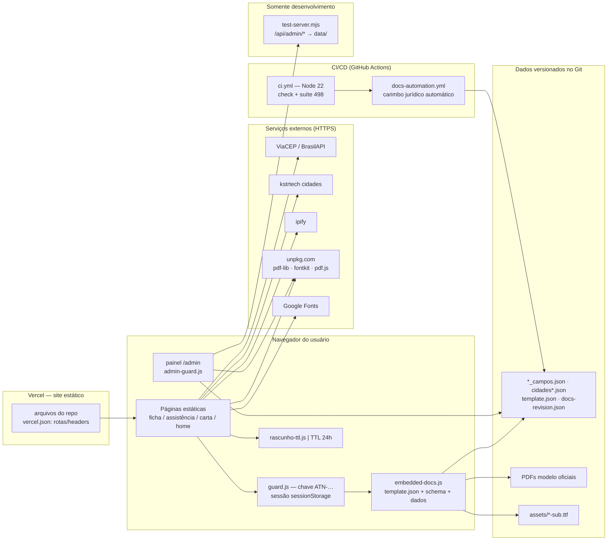
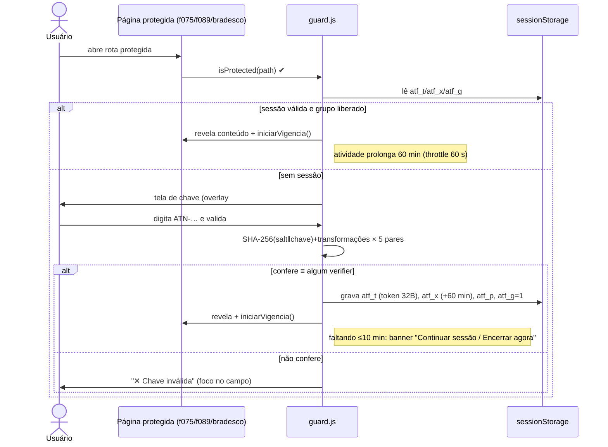
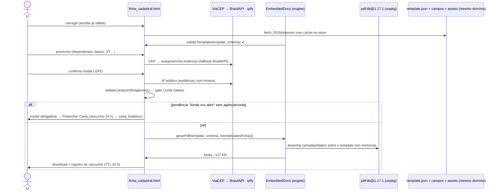
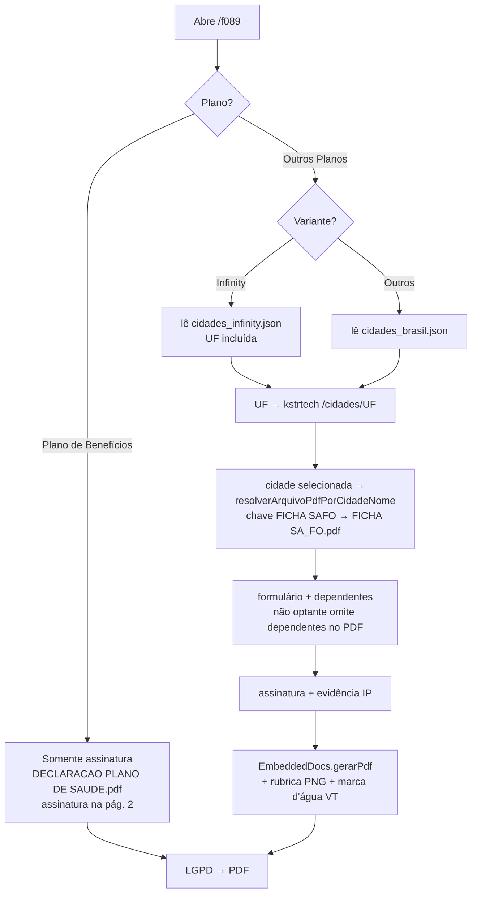
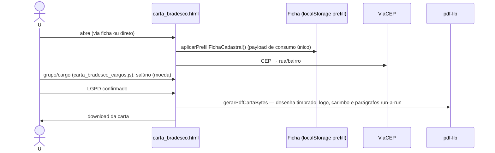
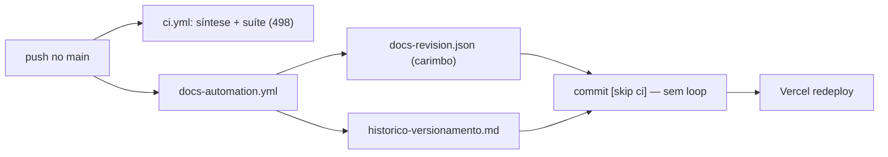
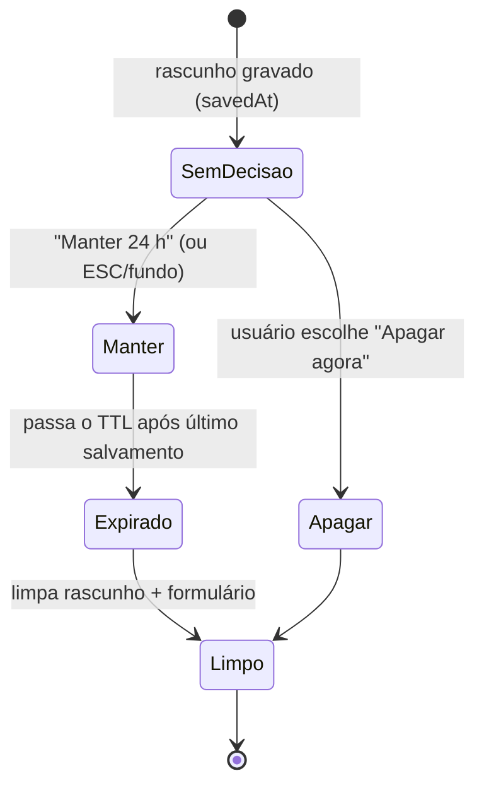

# Arquitetura e fluxos — auditória diagramada (25/10/2026)

Diagramas em Mermaid. Estado verificado no repositório; não descreve nada além do que existe.

---

## 1. Diagrama de arquitetura atual



**Leitura:** o cliente concentra 100% da lógica de dados; a edge (Vercel) só entrega arquivos e headers; a única escrita server-side do produto é do servidor **local** de dev em `data/`.

---

## 2. Fluxo A — Autenticação e sessão entre formulários



Falha tratada: expiração real → `encerrarSessaoPorExpiracao()` limpa as 4 chaves e recarrega (tela de chave volta). Navegação entre f075↔f089↔bradesco **não** repete a chave (`atf_g` cobre o grupo; `atf_p` mantém compatibilidade com sessões antigas).

---

## 3. Fluxo B — Ficha Cadastral → PDF (caminho feliz)



Tratamentos de falha: template/schema ausentes → toast e geração bloqueada; LGPD cancelado → nada é gerado; rascunho expira com a página aberta → modal + limpeza do formulário no vencimento.

---

## 4. Fluxo C — Assistência Médica (ramificação)



Dependência crítica: nome da cidade tem de bater entre o JSON da lista e `FICHA_UTILIZAR_PARA_ARQUIVO` nas duas pontas (app e painel); divergência = cidade sem template.

---

## 5. Fluxo D — Carta Bradesco



---

## 6. Fluxo E — Configuração (painel → aplicação pública)

```mermaid
sequenceDiagram
    actor A as Administrador
    participant AD as /admin (painel)
    participant DET as persistence.js detectMode()
    participant API as test-server.mjs (dev)
    participant REPO as JSONs/PDFs do repo
    participant VER as Vercel

    A->>AD: valida e-mail @atento.com + código exclusivo (CG)
    AD->>DET: sonda GET /api/admin/historico
    alt JSON ⇒ modo API (dev)
        AD->>API: PUT config (backup auto), POST upload (PDF assinatura/tamanho), POST historico
    else 404/HTML ⇒ modo exportação
        AD->>AD: sessão do navegador; Exportar JSON / Exportar arquivos do repo
    end
    AD->>AD: Editar overlay (Field Builder, editor visual, cidades)<br/>validarDocCampos no gate
    A->>REPO: substitui JSONs exportados (bit-a-bit = base + overlay)
    A->>VER: commit/push → deploy automático
    Note over A,VER: app pública lê os JSONs do repo — painel nunca lhes escreve direto
```

---

## 7. Fluxo F — Ciclo de docs LGPD (automático)



---

## 8. Fluxo G — Rascunho (TTL/decisão LGPD)


